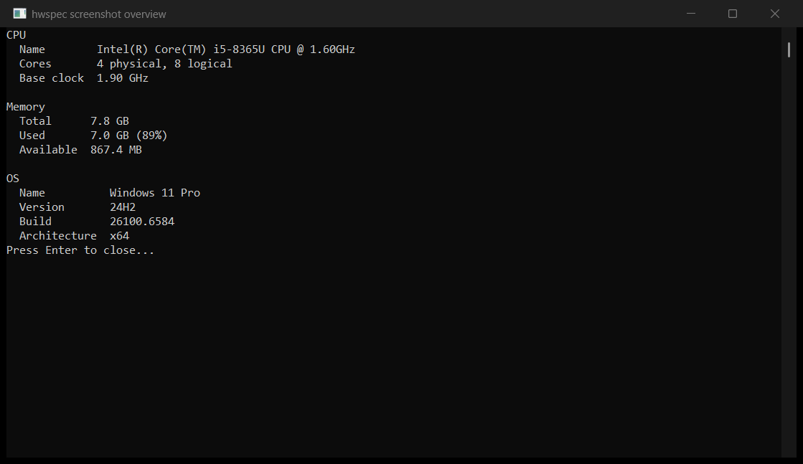
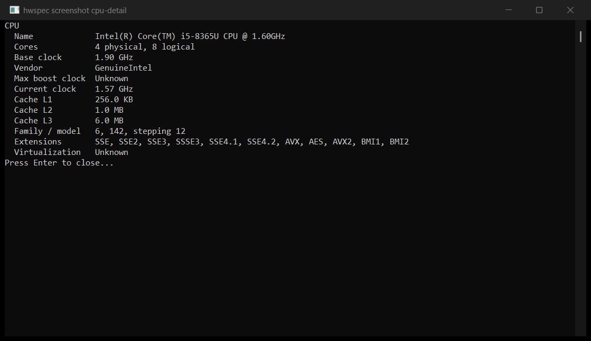

# hwspec

A small Windows 10/11 (x64) CLI for machine specifications, implemented in C++17.
The name **hwspec** is final; older project-plan examples saying `sysinfo` are placeholders.

**Status: native M5 preview v0.5.0 prepared; GitHub publication awaits access.**
The standalone executable, portable ZIP, per-user installer and winget manifest
passed local distribution/installer checks; see [M5 validation](docs/M5_VALIDATION.md).
The Python package remains published as v0.4.1. Native Windows MSVC/MinGW tests
and JSON smoke checks pass. All six CPython 3.9–3.14 Windows x64 wheels passed
local build/repair and installed-package validation. TestPyPI and PyPI each
passed a fresh CPython 3.12 installation and all 16 Python tests; see
[M4 validation](docs/M4_VALIDATION.md). Version 0.4.1 includes corrected total
CPU cache sizes and configured RAM speed, verified against the native CLI.
Remaining second-PC and
user-observed UAC rejection checks are tracked in [M2 validation](docs/M2_VALIDATION.md) and
[M3 validation](docs/M3_VALIDATION.md). M6 remains deferred.

## Native Windows installation (no Python)

The prepared v0.5.0 assets are listed in [M5 validation](docs/M5_VALIDATION.md).
Once published, download them from [GitHub Releases](https://github.com/maaz0166/hwspec/releases):

- **Installer:** run `hwspec-0.5.0-windows-x64-setup.exe`. It installs for your
  current account, with optional PATH setup. Open a new terminal afterward.
- **Portable:** extract `hwspec-0.5.0-windows-x64.zip` and run `./hwspec.exe`.
- **Single executable:** `hwspec-0.5.0-windows-x64.exe` can run directly; rename
  it to `hwspec.exe` if desired. No separate C++ runtime installation is needed.

```powershell
hwspec --cpu --mem --os
hwspec --all -d --json
```

The installer creates a Start menu entry that pauses after showing the output.
Uninstall through Windows **Installed apps** or the installed uninstaller. It
removes only PATH setup owned by this installer and preserves other entries.
The preview is unsigned; Windows may ask whether you trust the download.
The supplied winget manifest is validated but is **not yet in Microsoft's
community catalog**; no public `winget install` availability is claimed.

Real console output from the Windows 11 reference laptop (values vary by PC):





## Commands

```powershell
hwspec                          # all seven sections; normal mode
hwspec --cpu --mem --os         # choose sections in any order
hwspec --gpu --disk --net
hwspec --battery
hwspec --battery -d            # capacity, health and cycles when available
hwspec --cpu -d                # clocks, caches, CPUID, virtualization
hwspec --all --detail          # detailed view for every section
hwspec --disk -d --skip-admin  # disk details without privileged data or prompts
hwspec --disk -d --elevate     # reopen with Windows UAC; child text console pauses
hwspec --all --json            # machine-readable JSON
hwspec --battery --json -d     # typed JSON, null for unsupported fields
hwspec --no-color              # accepted; M2 text is uncolored
hwspec --help
```

`--detail`/`-d` adds fields; **normal mode omits** them from text and JSON.
`--all` overrides individual section flags. `--json` emits one JSON object per
section, in the order CPU, memory, OS, GPU, disk, network, battery. Arrays contain
multiple adapters/drives/RAM modules, numbers remain numbers, and missing values
are `null` (including battery presence when not detectable). In text they are shown as `Unknown`.

## M2 data collection

| Section | Normal | Additional details (`-d`) |
| --- | --- | --- |
| CPU | Name, cores, base clock | Vendor, current and maximum reported clock, L1/L2/L3 caches, family/model/stepping, extensions, virtualization firmware state |
| Memory | Total, used, available | RAM modules (slot, capacity, type, speed, manufacturer), page-file allocated and used |
| OS | Name, version, build, architecture | Uptime, install date, UBR revision, computer name |
| GPU | First DXGI adapter, dedicated VRAM | Every adapter, shared memory, vendor/device IDs, WMI driver version, matched active display mode |
| Disk | Logical drives, total and free capacity | File system, physical model, bus, firmware, SSD/HDD if Windows reports seek penalty |
| Network | Adapters, IPv4/IPv6 addresses | Link speed, connection state, MAC, gateway, DNS |
| Battery | Charge and power state or no-battery message | Design/full capacity, computed health %, cycle count |

Collection uses native Windows APIs first; RAM module/page-file and GPU driver
metadata rely on read-only WMI. WMI and device firmware may omit properties.
A battery must report **absolute mWh** values for health to be calculated; a
cycle count of zero or capacity reported in relative units remains unknown.

## Administrator handling (M3)

Only detailed disk health needs administrator rights. Normal `--disk` never
prompts. In an interactive text console, `--disk -d` offers skip (default), reopen
as administrator, or cancel. JSON, redirected runs and `--skip-admin` skip
privileged data without prompting. `--elevate` explicitly opens a new elevated
console with the same flags and `--pause`; its output stays in that console.
Declining UAC continues the original command with privileged data skipped.
`--pause` waits for Enter only in an interactive text console.

Detailed JSON contains `disk.disk_health.status`: `requires_admin` when skipped,
`unknown` when the query yields no usable values, and `available` when active
WMI device instances report a prediction. `devices` contains `instance_name`
and `failure_predicted` (boolean or null). Devices are reported separately from
logical volumes to avoid guessing mappings. A false prediction means no failure
is predicted; it does not guarantee a healthy disk. NVMe/USB/RAID drivers may
not support the legacy WMI SMART provider. Text uses `Unknown` for missing data.
`--skip-admin` also skips SMART in an already elevated shell.

Maximum boost clock is read from CPUID leaf 0x16 where available. Some CPUs do
not report it. The fallback registry MHz value for base clock may itself be
approximate, so compare CPU clock values with System Information and CPU-Z.
Firmware virtualization is Unknown when a hypervisor is present and Windows
does not expose the firmware availability flag reliably.
GPU display resolution is left unknown when hybrid graphics cannot be mapped
unambiguously. On VMs, some devices/batteries may not exist; empty arrays or
unknown fields do not mean zero hardware.

## Build & tests

### Native distribution (M5)

Requires Windows x64, MSVC/Visual Studio 2022, CMake, Inno Setup 6+ and winget.
Python is not required by this native build/package pipeline:

```powershell
./packaging/build_release.ps1
./tests/verify_portable.ps1 -Archive ./dist/native/hwspec-0.5.0-windows-x64.zip
./tests/verify_installer.ps1 -Installer ./dist/native/hwspec-0.5.0-windows-x64-setup.exe
```

The release build uses `HWSPEC_STATIC_RUNTIME=ON`; ordinary builds default to
the original runtime choice. Python builds reject combining that option with
the binding. Installer tests refuse to replace an existing hwspec installation
and restore the test account's original user PATH. Run them in a test account
or CI environment when hwspec is already installed for your account.

The manual **Native release** workflow runs the same checks. Its publication
input defaults off. Publishing an explicitly selected preview creates a draft,
uploads verified assets, then publishes; it never replaces existing releases.

### Python package (M4)

Install the published package with Windows x64 CPython 3.9–3.14:

```powershell
python -m pip install --upgrade hwspec==0.4.1
hwspec --cpu --json
```

The release is available on [PyPI](https://pypi.org/project/hwspec/0.4.1/).

Build from the repository root; packaging metadata is in root `pyproject.toml`
so the source archive includes the shared C++ implementation.

```powershell
python -m pip install build
python -m build
python -m pip install ./dist/hwspec-0.4.1-cp312-cp312-win_amd64.whl  # CPython 3.12
python -m hwspec --all --json
```

```python
import hwspec
data = hwspec.collect(["cpu", "mem"], detail=True)
```

Binary wheels need Windows x64 Python; source builds also need a C++ toolchain
and CMake. The API never prompts or elevates and uses `None` for missing data.
See [Python package usage](python/README.md) and
[M4 verification/publication status](docs/M4_VALIDATION.md). The six repaired
wheels and source archive are published on TestPyPI and PyPI with matching hashes.

For distribution, use the repaired wheels produced by cibuildwheel, as the
workflow does. Locally validated CPython 3.9–3.14 distribution wheels are in
`dist/0.4.1/wheels/`; their C++ runtime dependency is bundled. Plain `python -m build`
creates an unrepaired wheel suitable for local development on the build machine.

This project **runs on Windows x64**. CMake tests for formatting/CLI also build
on Linux with placeholder collectors; a Linux build does not report Linux data.

### MSVC / Visual Studio (recommended)

```powershell
cmake -S . -B build
cmake --build build --config Release --parallel
ctest --test-dir build -C Release --output-on-failure
python tests/smoke_json.py .\build\Release\hwspec.exe
.\build\Release\hwspec.exe --all --detail
```

### MinGW with CMake

```powershell
cmake -S . -B build -G Ninja -DCMAKE_BUILD_TYPE=Release
cmake --build build --parallel
ctest --test-dir build --output-on-failure
python tests/smoke_json.py .\build\hwspec.exe
.\build\hwspec.exe --all --detail
```

The Windows runner in `.github/workflows/ci.yml` builds MSVC, runs the full
suite, parses `--all --json` and `--all -d --json`, and uploads a CI artifact.
This does **not** constitute validation on two physical PCs; run the test matrix
in [`docs/M2_VALIDATION.md`](docs/M2_VALIDATION.md) to finish the milestone's
hardware acceptance check.

## Repository layout

- `core/include/hwspec/`: plain collector types, interfaces, formatter and JSON API
- `core/src/windows/`: Windows Win32/DXGI/WMI/device IOCTL collectors
- `core/src/stub/`: portable placeholder collectors for Linux test builds
- `core/src/format.cpp`, `json.cpp`: hardware-independent output functions
- `cli/`: arguments and reusable `run()` function (exe + future Python binding)
- `tests/`: CLI, admin decision table, format, JSON, hardware checks and smoke script
- `python/`: pybind11 extension and Python API/module/console entry points
- `pyproject.toml`: native wheel/sdist packaging and Windows cibuildwheel matrix

All section collectors return plain data without printing. Windows code stays
behind the core's public interfaces. The original M1 collector callbacks remain
compatible with existing tests/consumers.
